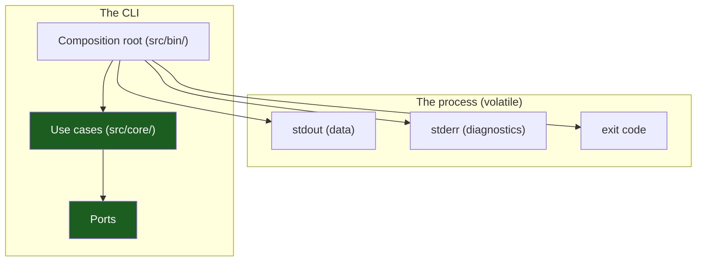

# Overview & Principles

The entry chapter. It states the one structural idea - **hexagonal (ports &
adapters) expressed as one headless core over consumer-owned ports, with a
versioned stdout/stderr and exit-code contract** - and the principles that
follow. Generic: the template ships one example use case (`greet`) that you
replace with your own domain.

## 1. The problem this solves

A scriptable CLI is not one program with one consumer. It is one core with
several front ends - the interactive TUI, print mode, resource subcommands and
an RPC server - that all read the same event stream, and a fleet of shell
scripts that branch on its exit codes and parse its output. If the code is
written as one flat bundle, the result is a core that knows about terminals,
a handler that writes UI chrome into a pipe, and an exit code that drifts
without anyone noticing. The architecture keeps them apart with one
discipline: **dependencies point inward, toward the rules, never outward
toward the process.**



The adapters are the only files that know the process exists.

## 2. The six principles

1. **The adapters own `process` and `node:`.** `src/adapters/**` is the only
   place allowed to touch the process streams and the Node builtins; ESLint
   and the architecture test both fail the build otherwise.
2. **stdout is data, stderr is diagnostics.** Progress, spinners and color go
   to stderr only, and never to stdout when stdout is not a TTY.
3. **No prompt in a pipe.** A piped (non-TTY) invocation fails with an
   actionable message instead of prompting.
4. **The envelope is versioned and shared.** `--json` output is one shape
   (`{ v, ok, data }` or `{ v, ok: false, error }`), parsed by every consumer.
5. **The exit-code table is the contract.** Each code has one documented
   meaning; scripts branch on these numbers and a change is a breaking change.
6. **The core is pure.** Use cases are functions over consumer-owned ports; a
   test injects a fake clock and the function stays input to output.

## 3. The chapter map

| #   | Chapter                                                              | What it covers                                            |
| --- | -------------------------------------------------------------------- | --------------------------------------------------------- |
| 01  | [Platform Model](01-platform-model-and-execution-contexts.md)        | TTY vs pipe, the lifecycle, the trust boundary            |
| 02  | [Service Worker Lifetime](02-service-worker-lifetime.md)             | Does not apply; the process-lifecycle analog              |
| 03  | [Layers & Ports](03-hexagonal-layers-and-mvvm.md)                    | Core, adapters, composition root, ports                   |
| 04  | [Vertical Slicing](04-vertical-slicing.md)                          | One feature per slice; the reduced template form          |
| 05  | [Directory Structure](05-directory-structure.md)                     | The tree, how to copy the template                        |
| 06  | [Manifest & Permissions](06-manifest-and-permission-engineering.md)  | Does not apply; the declared-surface analog               |
| 07  | [Messaging & the Stream Contract](07-messaging-and-sender-validation.md) | The stream contract and the argv boundary             |
| 08  | [Storage & Migrations](08-storage-and-migrations.md)                 | Does not apply to the template; the config analog         |
| 09  | [Policy](09-policy-admin-over-user.md)                               | Does not apply to the template; the config-precedence analog |
| 10  | [Security](10-security-and-csp.md)                                   | The trust boundaries; what the kit refuses                |
| 11  | [Telemetry](11-telemetry.md)                                         | Does not apply to the template; the observability analog  |
| 12  | [Testing & CI](12-testing-and-ci.md)                                 | The test tiers, the gates, the commands                   |
| 13  | [Playbooks](13-playbooks.md)                                         | The changes you will make most                            |
| 14  | [Glossary](14-glossary.md)                                           | Every term used in this set                               |

## 4. Worked example

The shipped `greet` use case is the worked example of every chapter:

```text
src/
├── core/contracts.ts        # ENVELOPE_VERSION, ExitCode, the envelopes
├── core/greet.ts            # the use case: greet(input, ports) over an injected clock
├── adapters/cli.ts          # the argv parser -> Invocation (a Result, never throws)
├── adapters/io.ts           # the stdio adapter -> Io { writeStdout, writeStderr }
└── bin/main.ts              # wires argv -> adapter -> core -> io -> exit code
```

`bin/main.ts` maps the envelope returned by `greet` onto stdout/stderr plus a
versioned exit code. A test calls `greet` with a fake clock and never touches
the terminal. That is the whole idea in one screen.

## Do / Don't

| Do                                             | Don't                                              |
| ---------------------------------------------- | -------------------------------------------------- |
| Put `process` and `node:` in `src/adapters/**` | Call `process.stdout` from a use case               |
| Return an envelope from a use case             | Throw for an expected failure                       |
| Change an exit code with a version bump        | Renumber an exit code silently                      |
| Validate argv into a `Result`                  | Let the argv parser throw across the boundary       |

## See also

- [Platform Model & Execution Contexts](01-platform-model-and-execution-contexts.md)
- [Playbooks](13-playbooks.md)
- [Glossary](14-glossary.md)
- The kit instruction file: [`AGENTS.md`](../AGENTS.md)
