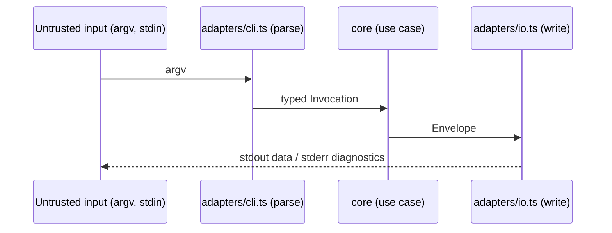

# Platform Model & Execution Contexts

A CLI runs in several contexts at once, distinguished by whether the standard
streams are terminals. Most CLI bugs are really context bugs: code written for
an interactive TTY tries to prompt inside a pipe, or a piped mode writes a
spinner into the data stream.

## 1. The contexts the kit ships

| Context            | Entry point       | Sees              | Behaviour                                              |
| ------------------ | ----------------- | ----------------- | ------------------------------------------------------ |
| Interactive (TTY)  | `src/bin/main.ts` | A terminal        | Prompts allowed; color and progress on stderr          |
| Piped (non-TTY)    | `src/bin/main.ts` | Plain streams     | No prompts; `--json` yields one envelope on stdout      |
| Script / CI        | `src/bin/main.ts` | Plain streams     | Plain text, no spinners; `CI=true` or `TERM=dumb`      |

The shipped template is a reduced form: it implements print mode (human text
or `--json`) and the `--version`/`--help` fast path. The interactive TUI, the
RPC server and `stream-json` are the fuller contexts specified in
`PLAYBOOK_CLI.md` sections 2 and 4 and are not wired in the template.

## 2. What each context may do

- **Interactive** may read a prompt and write color and progress - to stderr
  only, never into the stdout data stream.
- **Piped** must never prompt and must put nothing but the result (or one
  JSON envelope) on stdout; a failure is an actionable stderr message plus a
  versioned exit code.
- **Script / CI** degrades to plain text with no animation and no color,
  honouring `NO_COLOR`, `CI` and `TERM=dumb`.

## 3. The trust boundary, once



The dashed line is the boundary: everything left of the adapter is untrusted
input. The argv parser is where a string becomes a typed value, and it returns
a `Result` (`CliParse`) instead of throwing - an unknown command or a bad flag
is a usage error mapped to exit code 2, never a stack trace.

## 4. The platform layer

In this template the adapter layer *is* the platform boundary: `src/adapters/`
is the only folder allowed to name `process` and the `node:` builtins.

| File                  | Exposes        | Notes                                              |
| --------------------- | -------------- | -------------------------------------------------- |
| `src/adapters/cli.ts` | `parseArgv`    | argv → `Invocation`; returns `CliParse`, never throws |
| `src/adapters/io.ts`  | `nodeIo()`     | the real `process.stdout`/`process.stderr` writer  |

The adapters never return a `process` type across their boundary: `Io` is a
plain interface (`writeStdout`, `writeStderr`), so tests inject an in-memory
`Io` and no test ever touches the terminal.

## 5. Worked example

`bin/main.ts` reads the invocation, runs the use case, and maps the envelope
to the exit-code table:

```ts
const envelope = greet({ name: invocation.name }, { now: Date.now });
if (invocation.json) {
  io.writeStdout(`${JSON.stringify(envelope)}\n`);
  if (!envelope.ok) io.writeStderr(`error: ${envelope.error.message}\n`);
  return envelope.ok ? ExitCode.Ok : ExitCode.Validation;
}
```

The same `greet` runs unchanged under a test with a fake clock and a fake
`Io`, because the core never touches the process.

## Do / Don't

| Do                                               | Don't                                        |
| ------------------------------------------------ | -------------------------------------------- |
| Detect a pipe and degrade to promptless output   | Prompt inside a pipe                         |
| Put the `process` call in `src/adapters/`        | Import `node:` into a use case               |
| Treat argv as untrusted input                    | Trust a flag because it looks right          |
| Return a `Result` from the parser                | Throw from the parser across the boundary    |

## See also

- [Service Worker Lifetime](02-service-worker-lifetime.md)
- [Messaging & the Stream Contract](07-messaging-and-sender-validation.md)
- [Layers & Ports](03-hexagonal-layers-and-mvvm.md)
