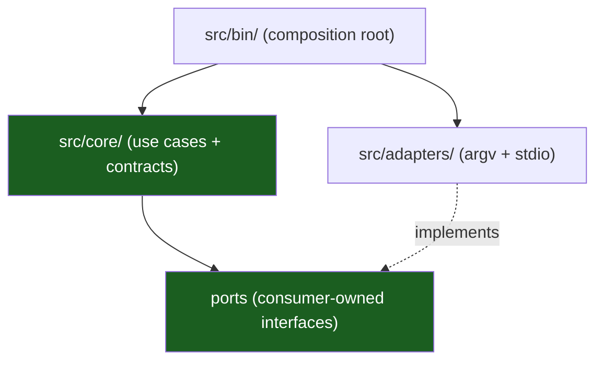

# Hexagonal Layers & Ports

The code is split by **what changes**: the product rules change when the
product changes, the mechanism changes when the platform changes. The split is
hexagonal (ports & adapters). The shipped template is a reduced form of the
fuller architecture in `PLAYBOOK_CLI.md` section 3 - it collapses the six
playbook layers into three folders that demonstrate the same discipline.

## 1. The layers of the template



| Layer            | Owns                                        | May import                | Must not import                    |
| ---------------- | ------------------------------------------- | ------------------------- | ---------------------------------- |
| `src/core/`      | Use cases and the versioned contracts       | the stdlib only           | `node:`, `process`, adapters, bin  |
| `src/adapters/`  | The argv parser and the stdio streams        | `node:*`, `core`          | the bin entry                      |
| `src/bin/`       | The composition root                        | `core`, `adapters`        | (it is the root)                   |

The ESLint rules and `tests/architecture.test.ts` enforce the same table:

- core never imports `node:` or `process`, and never reaches the adapters or
  the bin entry;
- adapters never import the bin entry.

The fuller playbook layers (`domain`, `application`, `adapters/in`,
`adapters/out`, `platform`, `contracts`) are the target a real product grows
into; the template's three folders are the smallest shape that demonstrates
the boundaries.

## 2. Ports: the interface the consumer owns

The core declares the interface it needs, not the interface the process
happens to offer:

```ts
export interface GreetPorts {
  now(): number;
}
```

`src/bin/main.ts` supplies the real clock (`Date.now`); a test supplies a
frozen one. The use case does not know which one it got, and it re-applies its
own rules to the input, so an adapter never decides what the core returns.

## 3. Errors as values

Expected failures are values, not exceptions:

```ts
export type Envelope<T> =
  | { v: typeof ENVELOPE_VERSION; ok: true; data: T }
  | { v: typeof ENVELOPE_VERSION; ok: false; error: { code: string; message: string } };
```

A use case returns `Envelope<Greeting>`; `greet` turns an empty name into
`{ ok: false, error: { code: "validation_failed", ... } }` and `bin` maps that
to exit code 7. Only a programming error (a thrown exception) escapes the
core, and it is the composition root's job to keep it off the data stream.

## 4. Worked example

One call, three layers:

```ts
// bin -> adapter -> core -> adapter -> io
const envelope = greet({ name }, { now: Date.now });
io.writeStdout(`${JSON.stringify(envelope)}\n`);
```

The same call works in a test with a fake clock and a fake `Io`, because the
use case never touches the process.

## Do / Don't

| Do                                           | Don't                                    |
| -------------------------------------------- | ---------------------------------------- |
| Declare the port in the consuming core       | Import `process` into a use case         |
| Keep the core free of `node:` and `process`  | Read `process.stdout` from a use case    |
| Return an `Envelope` for an expected failure | Throw for a validation failure           |
| Inject the clock and the streams at the root | Construct the adapters inside a use case |

## See also

- [Vertical Slicing](04-vertical-slicing.md)
- [Messaging & the Stream Contract](07-messaging-and-sender-validation.md)
- The example use case, file by file: [`src/core/greet.ts`](../src/core/greet.ts)
