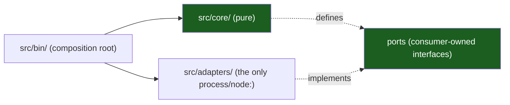

# CLI Template Documentation

The handbook of the terminal CLI/TUI template: **Node 24, TypeScript 5.9,
vitest, ESLint**. It describes the kit as it is - one headless core over
consumer-owned ports, the adapter boundary, the versioned stream and
exit-code contracts, and the gates.

> 14 chapters · 2 ADRs.

## The one rule

**The process is an adapter.** `src/adapters/**` is the only place allowed to
name `process` and the `node:` builtins; `src/core/` is pure and `src/bin/`
only wires. See [Layers & Ports](03-hexagonal-layers-and-mvvm.md) and
[Overview & Principles](00-overview-and-principles.md).

## Start here

New to the kit? Read [00 - Overview & Principles](00-overview-and-principles.md),
then [01 - Platform Model](01-platform-model-and-execution-contexts.md) and
[03 - Layers & Ports](03-hexagonal-layers-and-mvvm.md). Starting a project?
Jump to [05 - Directory Structure](05-directory-structure.md) and
[13 - Playbooks](13-playbooks.md). Reviewing a change? Read
[07 - Messaging & the Stream Contract](07-messaging-and-sender-validation.md)
and [10 - Security](10-security-and-csp.md).

## Chapters

| #   | Chapter                                                                       | What it covers                                             |
| --- | ----------------------------------------------------------------------------- | ---------------------------------------------------------- |
| 00  | [Overview & Principles](00-overview-and-principles.md)                        | The one idea, the principles, the chapter map              |
| 01  | [Platform Model & Execution Contexts](01-platform-model-and-execution-contexts.md) | TTY vs pipe, the process lifecycle, the trust boundary |
| 02  | [Service Worker Lifetime](02-service-worker-lifetime.md)                      | Does not apply to a CLI; the process-lifecycle analog      |
| 03  | [Hexagonal Layers & Ports](03-hexagonal-layers-and-mvvm.md)                   | Core, adapters, composition root, ports                    |
| 04  | [Vertical Slicing](04-vertical-slicing.md)                                    | One feature per slice; the reduced template form           |
| 05  | [Directory Structure & Project Skeleton](05-directory-structure.md)           | The tree, how to copy the template                         |
| 06  | [Manifest & Permission Engineering](06-manifest-and-permission-engineering.md) | Does not apply; the declared-surface analog                |
| 07  | [Messaging & Sender Validation](07-messaging-and-sender-validation.md)        | The stream contract and the argv boundary                  |
| 08  | [Storage & Migrations](08-storage-and-migrations.md)                          | Does not apply to the template; the config analog          |
| 09  | [Policy: Administrator Over User](09-policy-admin-over-user.md)                | Does not apply to the template; the config-precedence analog |
| 10  | [Security](10-security-and-csp.md)                                            | The trust boundaries; what the kit refuses                 |
| 11  | [Telemetry](11-telemetry.md)                                                  | Does not apply to the template; the observability analog   |
| 12  | [Testing & CI](12-testing-and-ci.md)                                          | The test tiers, the gates, the commands                    |
| 13  | [Playbooks](13-playbooks.md)                                                  | The changes you will make most                             |
| 14  | [Glossary](14-glossary.md)                                                    | Every term used in this set                                |

## Reference

| Document                                                              | What it covers                                              |
| --------------------------------------------------------------------- | ----------------------------------------------------------- |
| [ADR 0001 - TypeScript + Node stdlib, no bundler](adr/0001-typescript-and-node-stdlib-no-bundler.md) | The build: `tsc` to `dist/`, no Vite, the alternatives |
| [ADR 0002 - Core over ports, adapters own the process](adr/0002-core-over-ports-adapters-own-process.md) | Why the core is pure and the process is an adapter          |

## The gates

| Command                  | What it proves                                              |
| ------------------------ | ----------------------------------------------------------- |
| `make ci`                | Lint (ESLint layer walls), tests, evals, build             |
| `npm run test`           | The unit and architecture tests: no `process` outside `src/adapters` |
| `npm run evals`          | The `.claude` kit: agents, skills, commands, placeholder leaks |
| `bash scripts/verify-template.sh` | The template itself, renamed in a temp dir, gate by gate |

## Where the code is

| Topic            | File                                          |
| ---------------- | --------------------------------------------- |
| The contracts    | [`src/core/contracts.ts`](../src/core/contracts.ts) |
| The example use case | [`src/core/greet.ts`](../src/core/greet.ts)   |
| The argv parser  | [`src/adapters/cli.ts`](../src/adapters/cli.ts) |
| The stdio adapter | [`src/adapters/io.ts`](../src/adapters/io.ts) |
| The composition root | [`src/bin/main.ts`](../src/bin/main.ts)    |
| The layer walls  | [`tests/architecture.test.ts`](../tests/architecture.test.ts) |
| The agent guide  | [`AGENTS.md`](../AGENTS.md)                   |
