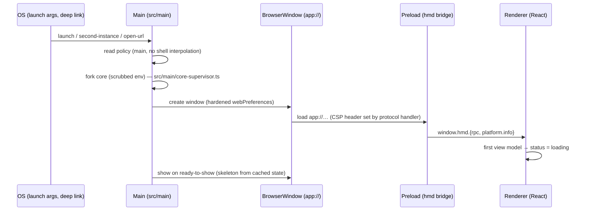
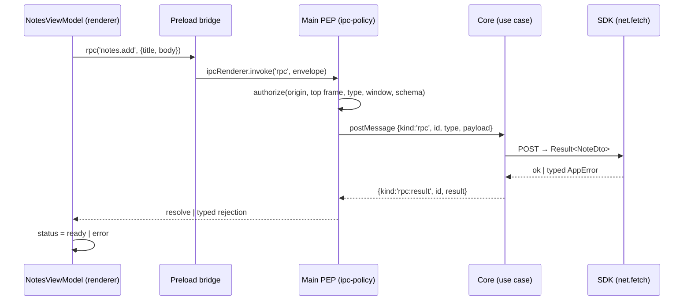

# Data Flows

Four flows, each with the trust boundary written on every hop. A hop with no
boundary named is a hop nobody reviewed.

- [Flow A — startup and first paint](#flow-a--startup-and-first-paint)
- [Flow B — a typed RPC round trip](#flow-b--a-typed-rpc-round-trip)
- [Flow C — a realtime event applied](#flow-c--a-realtime-event-applied)
- [Flow D — sign-in and the token path](#flow-d--sign-in-and-the-token-path)

## The rules the flows obey

1. Errors cross a boundary as values (`Result<T, AppError>`), never as thrown exceptions.
2. A payload from outside its layer is untrusted until a schema has parsed it; the IPC PEP re-validates on every message.
3. The URL never authorizes: the backend decides, the client reports.
4. Tokens never enter a renderer; the renderer-side schemas would reject the shape ([07](07-sdk-auth-and-realtime.md)).

## Flow A — startup and first paint



| # | Hop | Boundary | What crosses |
| --- | --- | --- | --- |
| 1 | OS → main | process creation | argv / deep link — untrusted input, parsed by a strict allowlist ([§7](../PLAYBOOK_DESKTOP_ELECTRON.md)) |
| 2 | main → core | process fork | a scrubbed environment, no secrets |
| 3 | main → window | trust anchor → **untrusted** | `app://` origin only; CSP with `connect-src 'none'` |
| 4 | preload → renderer | **the bridge** | named functions only, JSON data only |

## Flow B — a typed RPC round trip

Example: the renderer adds a note ([06](06-ipc-and-preload.md)).



| # | Hop | Boundary | What crosses |
| --- | --- | --- | --- |
| 1 | VM → bridge | renderer exit | JSON payload, already schema-shaped |
| 2 | bridge → PEP | **semi-trusted → trusted** | envelope `{v,id,type,correlationId,payload}` |
| 3 | PEP self-check | the turnstile | origin, top frame, unknown type, window capability, `.strict()` schema |
| 4 | PEP → core | trusted → trusted | validated payload only |
| 5 | core → SDK | **core → network** | `net.fetch` with system proxy/PAC/certs ([07](07-sdk-auth-and-realtime.md)) |
| 6 | return path | values both ways | `Result` or `AppError`; no stack traces to the renderer |

## Flow C — a realtime event applied

```text
backend ──SSE/WebSocket/poll──> core (owns the connection)
  core: validate envelope → dedupe by event id → apply to projection cache
  core ──event──> main ──fan-out (coalesced ≤ 30–60 Hz)──> subscribed renderers
  renderer: invalidate/refresh → ViewModel status change (batched)
```

| Hop | Boundary | What crosses |
| --- | --- | --- |
| backend → core | network, untrusted | schema-validated event envelopes; size caps; `Last-Event-ID` resume ([07](07-sdk-auth-and-realtime.md)) |
| core → main | trusted → trusted | topic + payload, already validated |
| main → renderer | **trusted → untrusted** | coalesced, per-subscription events; renderers never subscribe directly (direct MessagePort fan-out is a designed gap, [06](06-ipc-and-preload.md)) |

Lifecycle: `powerMonitor` suspend/resume and `net.online` drop half-open
sockets, resume with tokens, reconcile on show; `resyncRequired(topics)`
after a gap ([§9 of the playbook](../PLAYBOOK_DESKTOP_ELECTRON.md)).

## Flow D — sign-in and the token path

```text
renderer (sign-in intent) → PEP → core (session): build OIDC auth-code+PKCE URL
core → main: shell.openExternal(system browser)      ← redirect_uri = loopback 127.0.0.1:<port>
system browser → IdP → loopback server in core (single-use state, short timeout)
core: exchange code → access token (memory) + refresh token
core: safeStorage.seal(refresh) → opaque blob in the user data dir
renderers: session.get → { permissions[] } only — never a token
```

| Hop | Boundary | What crosses |
| --- | --- | --- |
| core → system browser | the user's browser | the auth URL only |
| IdP → loopback | **untrusted input** | code + state, validated single-use |
| core → disk | **secrets at rest** | ciphertext only (`safeStorage`; `basic_text` refused on Linux) |
| core → renderer | the bridge | `permissions[]` strings, **no tokens** (I-15) |

> **Known gap**: this flow is the design ([07](07-sdk-auth-and-realtime.md));
> the OIDC client, the loopback server and the rotation logic are not
> implemented in the kit.

## See also

- [02 — Processes & Trust](02-processes-and-trust.md)
- [§5, §8 and §9 of PLAYBOOK_DESKTOP_ELECTRON](../PLAYBOOK_DESKTOP_ELECTRON.md)
