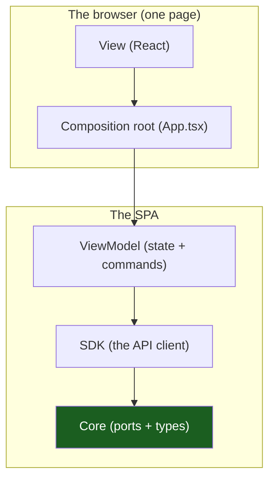

# Overview & Principles

The entry chapter. It states the one structural idea - **hexagonal (ports &
adapters) + MVVM, expressed inside a React 19 web SPA with a shared SDK** -
and the principles that follow. Generic: the template ships one example
feature (the lead detail screen) that you replace with your own.

## 1. The problem this solves

A web SPA is one program, but a badly organised one becomes three programs
that should have stayed one: components that fetch, state that lives inside
JSX, and a network call shape that drifts from the backend contract. If the
code is written as one flat bundle, the result is a View that reaches for
`fetch`, a ViewModel that imports React, and a route path hand-written in six
places. The architecture keeps them apart with one discipline:
**dependencies point inward, toward the rules, never outward toward the
platform.**



The composition root is the only file that knows every layer.

## 2. The eight principles

1. **The SDK owns the network.** `src/sdk/` is the only place a backend call
   happens; ESLint and the architecture test fail the build otherwise.
2. **`core`, `sdk` and `viewmodels` are React-free.** The platform-specific
   code is the View and the hook binding, nothing else.
3. **Keep no state in a module global** that must survive a reload. The
   ViewModel holds the session state; nothing else does.
4. **Contracts are typed, shared by one source.** The SDK namespace and the
   route builders mirror the URL playbook, so a shape change breaks one side
   only.
5. **Validate at the boundary.** The SDK maps a backend failure to a typed
   `SdkError`; a ViewModel never sees a status code.
6. **Features are sealed.** A slice never imports another slice; shared code
   goes to `src/core`.
7. **Errors are values.** A use case returns `Result<T, SdkError>`, never
   throws for an expected failure.
8. **Least privilege.** A public client ships no secret; an environment
   variable or a port change is a review, not a one-line change.

## 3. The chapter map

| #   | Chapter                                                                       | What it covers                                     |
| --- | ----------------------------------------------------------------------------- | -------------------------------------------------- |
| 01  | [Platform Model](01-platform-model-and-execution-contexts.md)                  | One context, the ports, the adapters               |
| 02  | [Service Worker Lifetime](02-service-worker-lifetime.md)                       | Not applicable to this kit - stated explicitly     |
| 03  | [Layers & MVVM](03-hexagonal-layers-and-mvvm.md)                               | Core, SDK, ViewModels, Views                       |
| 04  | [Vertical Slicing](04-vertical-slicing.md)                                     | One feature per slice, the example lead detail     |
| 05  | [Directory Structure](05-directory-structure.md)                               | The tree, the imports, the project skeleton         |
| 06  | [Environment & Configuration](06-manifest-and-permission-engineering.md)       | The VITE_ variables, no manifest in this kit       |
| 07  | [The SDK Request Boundary](07-messaging-and-sender-validation.md)             | The SDK as the trust boundary, the typed errors    |
| 08  | [Client Storage & Migrations](08-storage-and-migrations.md)                    | No storage layer shipped - stated explicitly       |
| 09  | [Permissions & Guards](09-policy-admin-over-user.md)                           | No admin policy - stated explicitly                |
| 10  | [Security & CSP](10-security-and-csp.md)                                      | Trust boundaries, the public client, the gaps      |
| 11  | [Telemetry](11-telemetry.md)                                                   | No telemetry shipped, and what that means          |
| 12  | [Testing & CI](12-testing-and-ci.md)                                           | The test tiers, the gates, the commands            |
| 13  | [Playbooks](13-playbooks.md)                                                   | The changes you will make most                     |
| 14  | [Glossary](14-glossary.md)                                                     | Every term used in this set                        |

## 4. Worked example

The shipped lead detail feature is the worked example of every chapter:

```text
src/core/types.ts                      # Lead, Stage, SdkError, LeadId
src/core/ports.ts                      # Transport, TokenStore, Navigator, Notifier
src/core/result.ts                     # Result<T, E>
src/core/routes.ts                      # routes.app.lead, routes.app.campaign
src/sdk/index.ts                        # createSdk, the typed SdkError mapping
src/sdk/fetch-transport.ts              # the web Transport adapter
src/viewmodels/lead-detail-view-model.ts # the state and the commands, no React
src/views/useLeadDetailViewModel.ts      # the React hook binding
src/views/LeadDetailView.tsx             # the View
src/App.tsx                              # the composition root
```

The composition root imports `createSdk`, `createLeadDetailViewModel` and
`LeadDetailView` and wires them together. The View never imports the SDK, the
ViewModel never imports React. That is the whole idea in one screen.

## Do / Don't

| Do                                                | Don't                                          |
| ------------------------------------------------- | ---------------------------------------------- |
| Put the backend call in `src/sdk/`                | Call `fetch` from a component or a ViewModel   |
| Read the access token through the `TokenStore`    | Bake a token into the build                     |
| Add a route through the `core` route builder      | Concatenate a path in a View                    |
| Return `Result` from a use case                   | Throw for an expected failure                   |

## See also

- [Platform Model & Execution Contexts](01-platform-model-and-execution-contexts.md)
- [Playbooks](13-playbooks.md)
- [Glossary](14-glossary.md)
- The kit instruction file: [`AGENTS.md`](../AGENTS.md)
