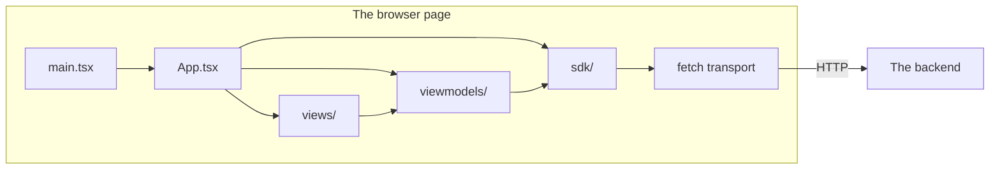
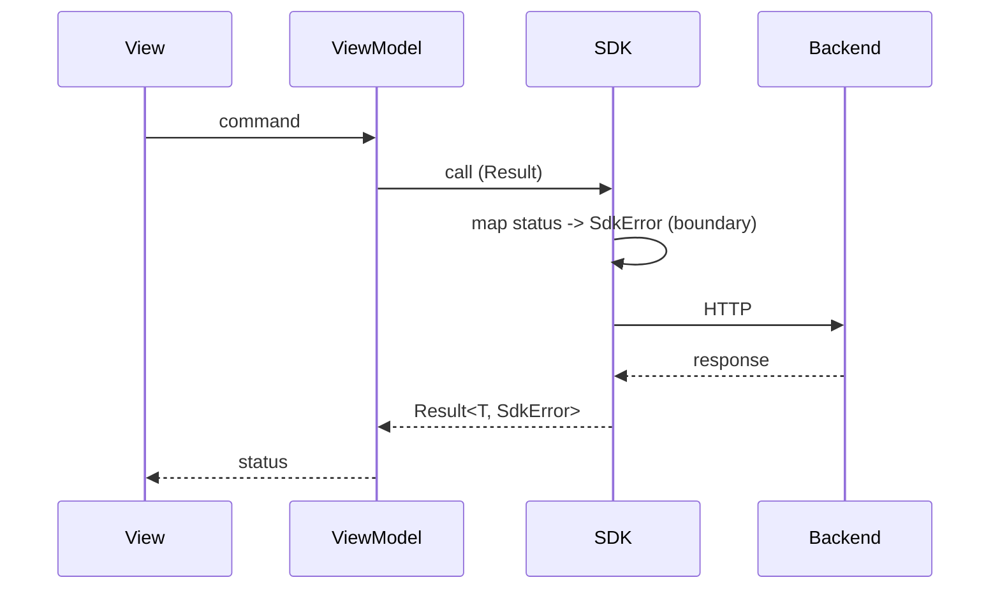

# Platform Model & Execution Contexts

A web SPA runs in exactly one execution context: a browser page. What the
extension kit calls "execution contexts" (a worker, a panel, a content
script) does not exist here, and that is the point: the shared layers are
written against **ports**, so the same SDK and ViewModel run unchanged on
the web, on native and in an extension shell.

## 1. The one context the kit ships

| Context     | Entry point      | Lifetime                | Sees                       | Trust                       |
| ----------- | ---------------- | ----------------------- | -------------------------- | --------------------------- |
| Browser page | `src/main.tsx`  | As long as the tab lives | The DOM, the web `fetch`  | The user's session           |



## 2. The platform model

The template does not depend on a platform global in the shared layers.
Instead, `src/core/ports.ts` declares the four ports the SDK and the
ViewModels receive at construction, and the composition root supplies the
adapters:

| Port          | What it abstracts                                   | The web adapter                        |
| ------------- | --------------------------------------------------- | -------------------------------------- |
| `Transport`   | The HTTP-like request shape                          | `src/sdk/fetch-transport.ts` (`fetch`) |
| `TokenStore`  | The access token (never the refresh token)          | a closure in `src/App.tsx`              |
| `Navigator`   | Routing without a router library                     | `window.location.assign` in `App.tsx`  |
| `Notifier`    | User-visible messages, keyed by message id          | no-ops in `App.tsx`                    |

Because the SDK and the ViewModels import only `core` (never `fetch`, never
`window`, never React), the web SPA, the mobile kit and the extension kit can
share them verbatim and supply their own adapters. The platform never leaks a
browser type across a port boundary: a port returns a plain value, never a
`Response` or a DOM node.

## 3. The trust boundary, once



The dashed line is the boundary: everything to the right of the SDK is
untrusted input. The SDK is where a response becomes either a typed value or
a typed error, and it never lets a status code, a header or a raw body cross
into a ViewModel.

## 4. What each layer may do

- **`src/core/`** holds the ports and the pure types. It imports nothing and
  knows nothing about the browser.
- **`src/sdk/`** is the typed API client. It is the only layer that talks to
  the backend, and it is the only layer that names `fetch` (through the web
  transport adapter).
- **`src/viewmodels/`** holds presentation state and commands. It reads the
  SDK through the `Result` half of every call and never inspects raw HTTP.
- **`src/views/`** is the React surface. It renders the ViewModel state and
  forwards events; it never fetches and never imports the SDK.
- **`src/App.tsx`** is the composition root. It wires the web adapters, the
  SDK and the ViewModel together.

## 5. Worked example

The composition root supplies the web adapters and builds the one ViewModel:

```ts
const sdk = createSdk({ baseUrl: "", transport: fetchTransport, tokenStore });
const viewModel = createLeadDetailViewModel({ sdk, leadId, navigator, notifier });
```

The ViewModel does not know whether `transport` is the web `fetch`, a native
HTTP client or a mock; it calls the SDK and reads the `Result`.

## Do / Don't

| Do                                                 | Don't                                          |
| -------------------------------------------------- | ---------------------------------------------- |
| Abstract the platform behind `core` ports          | Import `fetch` or `window` into a ViewModel    |
| Supply the web adapters in the composition root    | Construct an adapter inside a component        |
| Treat a backend response as untrusted input         | Trust a response because the route is known    |
| Share the SDK and the ViewModel across platforms   | Duplicate a ViewModel per platform             |

## See also

- [Hexagonal Layers & MVVM](03-hexagonal-layers-and-mvvm.md)
- [The SDK Request Boundary](07-messaging-and-sender-validation.md)
- [ADR 0001 - Vite as the build](adr/0001-vite-as-the-build.md)
