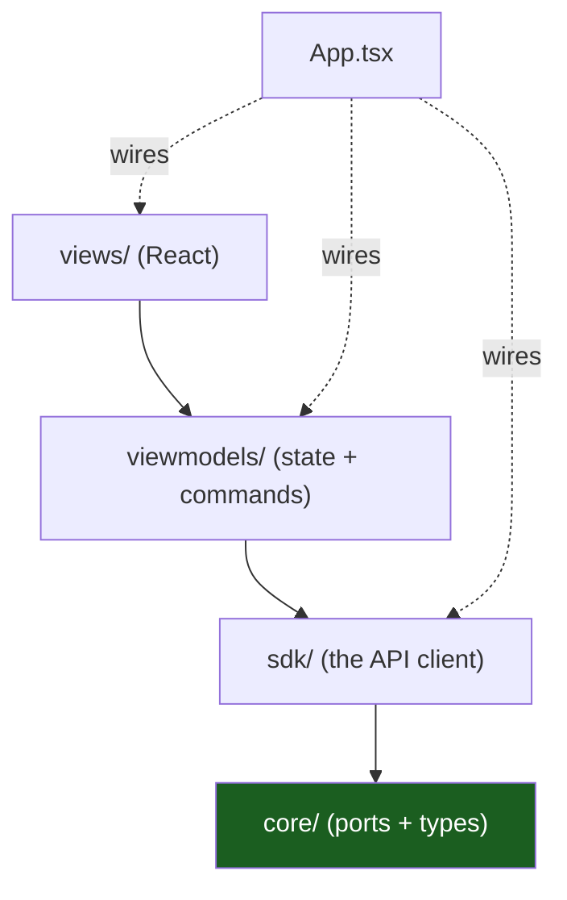

# Hexagonal Layers & MVVM

The code is split by **what changes**: the product rules change when the
product changes, the mechanism changes when the platform changes. The split
is hexagonal (ports & adapters) on one side and MVVM on the other - the two
meet at the ViewModel.

## 1. The layers



| Layer            | Owns                                      | May import               | Must not import                 |
| ---------------- | ----------------------------------------- | ------------------------ | ------------------------------- |
| `core/`          | Ports, pure types, `Result`, route builders | nothing but itself      | React, the SDK, the ViewModels  |
| `sdk/`           | The typed API client, the fetch transport | `core`                   | React, the ViewModels, the Views |
| `viewmodels/`    | Presentation state and commands           | `core`, `sdk`            | React, `react-dom`, the Views   |
| `views/`         | The React hook binding and the components | `core`, `viewmodels`     | the SDK                         |
| `App.tsx`        | The composition root                      | every layer              | nothing (it is the root)        |

Two machines enforce the table:

- **ESLint** (`eslint.config.mjs`) forbids `react`, `react-dom` and
  `react-native` in `core`, `sdk` and `viewmodels`, and `react-native` in
  `views`.
- **The vitest architecture test** (`tests/architecture/architecture.test.ts`)
  resolves every relative import to the layer it targets and fails on a
  forbidden edge.

## 2. Ports: the interface the consuming layer owns

The shared layers declare the interface they need, not the interface the
browser happens to offer:

```ts
export interface Transport {
  request(path: string, init?: TransportInit): Promise<TransportResponse>;
}
```

`src/sdk/fetch-transport.ts` implements it over `fetch`. A test implements it
with a fake. The SDK does not know which one it got, and it re-maps whatever
comes back into a `Result`, so a transport never decides what a surface may
render.

## 3. MVVM, mapped onto the SPA

| MVVM part | In this kit                              | Notes                                        |
| --------- | ---------------------------------------- | -------------------------------------------- |
| Model     | `core/` types + the backend              | Pure types; the source of truth is the backend |
| View      | `views/LeadDetailView.tsx`               | A pure function of the ViewModel state        |
| ViewModel | `viewmodels/lead-detail-view-model.ts`   | State, commands and their transitions         |
| Binding   | `views/useLeadDetailViewModel.ts`        | `useSyncExternalStore` over `getState`/`subscribe` |
| Repository| `sdk/`                                   | The API client, injected at the root          |

The ViewModel holds a `LeadDetailStatus` (`loading`, `ready`, `forbidden`,
`not-found`, `error`), the lead, an `isSaving` flag and an `errorKey`. It
exposes `getState`, `subscribe`, `load`, `moveToStage` and `openCampaign`.
The React component only renders that state and calls those commands, so the
whole screen can be tested without a DOM.

## 4. Errors as values

Expected failures are values, not exceptions:

```ts
export type Result<T, E> =
  | { readonly ok: true; readonly value: T }
  | { readonly ok: false; readonly error: E };
```

The SDK returns `Result<Lead, SdkError>`; the ViewModel turns a failure into
`status: "error"` and an `errorKey`; the View renders it in a `role="alert"`
region. Only a programming error (a thrown exception) reaches the boundary -
and it stops at the composition root.

## 5. Worked example

One call, three layers:

```ts
// view -> viewmodel -> sdk -> transport -> fetch
await viewModel.moveToStage("qualified");
//   calls sdk.app.funnels.leads.update(leadId, { stage })
//   the transport issues a PATCH
//   the SDK maps the status into Result<Lead, SdkError>
//   the ViewModel sets status + notifier through the port
```

The same call works in a test with a fake transport and a fake notifier,
because the ViewModel never touches the browser.

## Do / Don't

| Do                                         | Don't                                     |
| ------------------------------------------ | ----------------------------------------- |
| Declare the port in `core`                 | Import `fetch` into a ViewModel           |
| Keep `core`, `sdk` and `viewmodels` React-free | Put a `useState` in a ViewModel       |
| Return `Result` for an expected failure    | Throw `Error` for a validation failure    |
| Inject the adapters at the root            | Construct the SDK inside a component      |

## See also

- [Vertical Slicing](04-vertical-slicing.md)
- [The SDK Request Boundary](07-messaging-and-sender-validation.md)
- The example feature, file by file: [`src/viewmodels/lead-detail-view-model.ts`](../src/viewmodels/lead-detail-view-model.ts)
