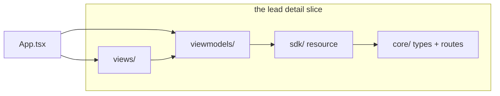

# Vertical Slicing

A **slice** is one feature, cut end to end: its types, its SDK resource, its
ViewModel and its View. Slices are the unit of work, of review and of
ownership. The template ships exactly one, the lead detail screen, as the
reference.

## 1. What a slice owns

| Asset       | Owner of the lead detail slice                                       |
| ----------- | -------------------------------------------------------------------- |
| Types       | `Lead`, `Stage`, `SdkError`, `LeadId` in `src/core/types.ts`          |
| SDK resource| `sdk.app.funnels.leads` in `src/sdk/index.ts`                         |
| Route       | `routes.app.lead` and `routes.app.campaign` in `src/core/routes.ts`   |
| ViewModel   | `src/viewmodels/lead-detail-view-model.ts`                            |
| View        | `src/views/LeadDetailView.tsx`                                        |

Two slices never share a route builder, never share an SDK resource and never
import each other. The dependency direction is enforced by the architecture
test, and the React-free walls by ESLint, so a slice cannot reach sideways
into another slice without failing the gate.

## 2. The anatomy of a slice



- **The layers are the slice's public face.** The composition root imports
  `createSdk`, `createLeadDetailViewModel` and `LeadDetailView`, never a layer
  inside them. A slice may reorganise its internals without touching the root.
- **`core/` re-exports nothing by feature.** The pure types and route
  builders are the shared shapes; a slice reaches for them directly, not
  through a feature barrel.

## 3. Where the cross-slice code goes

| Need                            | Home                                  |
| ------------------------------- | ------------------------------------- |
| A shape two layers must agree on | `src/core/types.ts`                  |
| A stable error envelope         | `src/core/types.ts` (`SdkError`)      |
| A `Result`                      | `src/core/result.ts`                  |
| A port                          | `src/core/ports.ts`                   |
| A route builder                 | `src/core/routes.ts`                  |
| A rule two features share       | Extract it into `src/core` - never import across slices |

The kit does not ship a "shared features" folder on purpose: the moment two
slices need the same code, that code was not slice code.

## 4. Adding a slice

The `add-slice` skill (`.claude/skills/add-slice/SKILL.md`) and the
`/add-slice` command (`.claude/commands/add-slice.md`) carry the full recipe.
The short version:

1. Write the `core` types first: the entity, its invariants, its `SdkError`
   cases.
2. Add the SDK resource (the namespace mirrors the URL playbook).
3. Write the ViewModel with the port dependencies injected.
4. Write the View and the hook binding.
5. Wire the layers in `src/App.tsx`.
6. Write the tests under `tests/unit/<layer>/`.

## 5. Worked example

The lead detail slice is reached from the composition root:

```ts
// src/App.tsx
import { createSdk } from "./sdk";
import { fetchTransport } from "./sdk/fetch-transport";
import { createLeadDetailViewModel } from "./viewmodels/lead-detail-view-model";
import { LeadDetailView } from "./views/LeadDetailView";
```

The View and the SDK share the slice's types but never each other's internals,
and the two never import each other.

## Do / Don't

| Do                                              | Don't                                                 |
| ----------------------------------------------- | ----------------------------------------------------- |
| Give every slice its own `core` types           | Store two features under one SDK resource             |
| Import a slice through its top-level layer       | Import `src/views/LeadDetailView.tsx` from a ViewModel |
| Put a shared type in `src/core`                 | Export a shared entity from one slice and import it in another |
| Add a slice with its own tests                  | Extend the lead detail slice with an unrelated feature |

## See also

- [Layers & MVVM](03-hexagonal-layers-and-mvvm.md)
- [Directory Structure](05-directory-structure.md)
- [Playbooks](13-playbooks.md)
