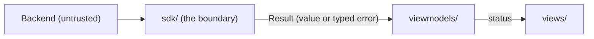

# The SDK Request Boundary

**There is no message protocol in this kit.** The reference extension kit has
a message bus and a sender allowlist; a web SPA has neither. What it has
instead is one inbound channel - the backend response - and the same rule
applies: **every value that crosses the boundary is untrusted until the SDK
has validated it.**

## 1. The boundary

The SDK is the only code that talks to the backend, and it is the only place
a raw response is turned into something the app may render:

```ts
if (response.status >= 200 && response.status < 300) {
  return ok<T, SdkError>(response.body as T);
}
return err<T, SdkError>(toSdkError(response.status, response.body));
```

A response is either a typed value or a typed error. A status code, a header
or a raw body never reaches a ViewModel.

## 2. The typed error envelope

`src/core/types.ts` defines the closed set the SDK maps every failure into:

```ts
export type SdkError =
  | { readonly kind: "unauthenticated" }
  | { readonly kind: "forbidden"; readonly requiredPermission?: string }
  | { readonly kind: "not-found" }
  | { readonly kind: "conflict" }
  | { readonly kind: "validation"; readonly fields: Record<string, string> }
  | { readonly kind: "rate-limited"; readonly retryAfterMs?: number }
  | { readonly kind: "network" }
  | { readonly kind: "server"; readonly correlationId?: string };
```

The mapping in `src/sdk/index.ts` is the whole surface of the client: the
status, the kind, and the fields a ViewModel may read. A status that is not
mapped falls through to `server`.

## 3. The order of checks in the client

`createSdk` checks in this order, and stops at the first failure:

| # | Check                          | Result                       |
| - | ------------------------------ | ---------------------------- |
| 1 | read the access token          | `authorization: Bearer <token>` when present |
| 2 | run the transport              | `network` error on a thrown call |
| 3 | map the status to a `SdkError` | the typed error half        |
| 4 | return the body as the value   | `ok` on 2xx                 |

Step 2 before step 3 is the point: a transport failure is caught as a value,
never thrown into the ViewModel.

## 4. What the client refuses

| Refused                                  | Where                                                        |
| ---------------------------------------- | ------------------------------------------------------------ |
| `react` in `core`, `sdk` or `viewmodels` | ESLint `no-restricted-imports`                               |
| A forbidden relative import             | `tests/architecture/architecture.test.ts`                     |
| A View or ViewModel that fetches        | The architecture test + the layer rule                       |
| A status the SDK does not map           | `toSdkError` falls through to `server`                        |
| A raw HTTP value in a ViewModel         | The SDK returns `Result`, never a `Response`                 |

## 5. The trust boundary, once



Everything left of the SDK is untrusted input. The SDK is where a response
becomes an action, and it re-checks every response - the status of a previous
call is not a credential.

## 6. Worked example

A ViewModel loads a lead:

```ts
const result = await sdk.app.funnels.leads.get(leadId);
if (!result.ok) {
  set({ status: statusFromSdkError(result.error), errorKey: messageKeyFromSdkError(result.error), lead: null });
  return;
}
set({ status: "ready", lead: result.value, errorKey: null });
```

A `403` becomes `status: "forbidden"` and `errorKey: "lead.error.forbidden"`;
the View renders a message key, never the raw body.

## Do / Don't

| Do                                            | Don't                                     |
| --------------------------------------------- | ----------------------------------------- |
| Map the status to a typed `SdkError`          | Read `response.status` in a ViewModel     |
| Return `Result` from every SDK call           | Throw across the layer boundary           |
| Validate the response before the value        | Trust a body because the route is known   |
| Read the token through the `TokenStore`       | Hard-code a token in the client           |

## See also

- [Security & CSP](10-security-and-csp.md)
- [Layers & MVVM](03-hexagonal-layers-and-mvvm.md)
- The SDK, file by file: [`src/sdk/index.ts`](../src/sdk/index.ts)
