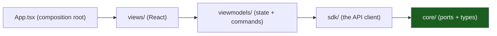

# Frontend Template Documentation

The handbook of the frontend template: **React 19, Vite, TypeScript, MVVM
with a shared SDK**. It describes the kit as it is - the layers, the ports,
the SDK, the routes and the gates.

> 14 chapters - 2 ADRs.

## The one rule

**The SDK is the only thing that talks to the backend.** `src/core/` holds the
ports and the pure types, `src/sdk/` is the typed API client, `src/viewmodels/`
holds presentation state and commands, and `src/views/` renders. See
[Layers & MVVM](03-hexagonal-layers-and-mvvm.md) and
[Directory Structure](05-directory-structure.md).

## Start here

New to the kit? Read [00 - Overview & Principles](00-overview-and-principles.md),
then [03 - Layers & MVVM](03-hexagonal-layers-and-mvvm.md). Starting a
project? Jump to [05 - Directory Structure](05-directory-structure.md) and
[13 - Playbooks](13-playbooks.md). Reviewing a change? Read
[10 - Security](10-security-and-csp.md) and
[12 - Testing & CI](12-testing-and-ci.md).

## Chapters

| #   | Chapter                                                                       | What it covers                                        |
| --- | ----------------------------------------------------------------------------- | ----------------------------------------------------- |
| 00  | [Overview & Principles](00-overview-and-principles.md)                         | The one idea, eight principles, the chapter map       |
| 01  | [Platform Model & Execution Contexts](01-platform-model-and-execution-contexts.md) | One context, the ports, the adapters              |
| 02  | [Service Worker Lifetime](02-service-worker-lifetime.md)                       | Not applicable to this kit - stated explicitly        |
| 03  | [Hexagonal Layers & MVVM](03-hexagonal-layers-and-mvvm.md)                     | Core, SDK, ViewModels, Views, ports                   |
| 04  | [Vertical Slicing](04-vertical-slicing.md)                                     | One feature per slice, the example lead detail        |
| 05  | [Directory Structure & Project Skeleton](05-directory-structure.md)            | The tree, the imports, how to copy the template       |
| 06  | [Environment & Configuration](06-manifest-and-permission-engineering.md)        | The VITE_ variables, no manifest in this kit          |
| 07  | [The SDK Request Boundary](07-messaging-and-sender-validation.md)              | The SDK as the trust boundary, the typed errors       |
| 08  | [Client Storage & Migrations](08-storage-and-migrations.md)                    | No storage layer shipped - stated explicitly          |
| 09  | [Permissions & Guards](09-policy-admin-over-user.md)                           | No admin policy - stated explicitly                   |
| 10  | [Security & CSP](10-security-and-csp.md)                                       | The boundaries, the public client, the known gaps     |
| 11  | [Telemetry](11-telemetry.md)                                                   | No telemetry shipped, and what that means             |
| 12  | [Testing & CI](12-testing-and-ci.md)                                           | The test tiers, the gates, the commands               |
| 13  | [Playbooks](13-playbooks.md)                                                   | The changes you will make most                        |
| 14  | [Glossary](14-glossary.md)                                                     | Every term used in this set                           |

## Reference

| Document                                                                        | What it covers                                                  |
| ------------------------------------------------------------------------------- | --------------------------------------------------------------- |
| [ADR 0001 - Vite as the build](adr/0001-vite-as-the-build.md)                   | The build, the `dist/` output, the alternatives                 |
| [ADR 0002 - npm and the committed lockfile](adr/0002-npm-and-the-committed-lockfile.md) | Why npm with a committed `package-lock.json`            |

## The gates

| Command           | What it proves                                              |
| ----------------- | ----------------------------------------------------------- |
| `make ci`         | Typecheck, lint (ESLint walls), tests, build                 |
| `npm run test`    | The unit tests plus the dependency-direction architecture test |
| `npm run evals`   | The `.claude` kit: agents, skills, commands, SDK posture    |
| `npm run verify`  | The template itself, renamed in a temp dir, gate by gate    |

## Known gaps of the template

| Gap                                                    | Where it is documented                                      |
| ------------------------------------------------------- | ----------------------------------------------------------- |
| The full SDK interceptor stack is not implemented       | [The SDK Request Boundary](07-messaging-and-sender-validation.md) |
| The DTOs are hand-written, not generated from OpenAPI   | [Layers & MVVM](03-hexagonal-layers-and-mvvm.md)             |
| No client storage layer ships                           | [Client Storage & Migrations](08-storage-and-migrations.md)  |
| No route guard is implemented                           | [Permissions & Guards](09-policy-admin-over-user.md)         |

## Where the code is

| Topic                 | File                                                          |
| --------------------- | ------------------------------------------------------------- |
| The ports             | [`src/core/ports.ts`](../src/core/ports.ts)                   |
| The pure types        | [`src/core/types.ts`](../src/core/types.ts)                   |
| The result type       | [`src/core/result.ts`](../src/core/result.ts)                 |
| The route builders    | [`src/core/routes.ts`](../src/core/routes.ts)                 |
| The SDK               | [`src/sdk/index.ts`](../src/sdk/index.ts)                     |
| The fetch transport   | [`src/sdk/fetch-transport.ts`](../src/sdk/fetch-transport.ts) |
| The example ViewModel | [`src/viewmodels/lead-detail-view-model.ts`](../src/viewmodels/lead-detail-view-model.ts) |
| The composition root  | [`src/App.tsx`](../src/App.tsx)                               |
| The agent guide       | [`AGENTS.md`](../AGENTS.md)                                   |
